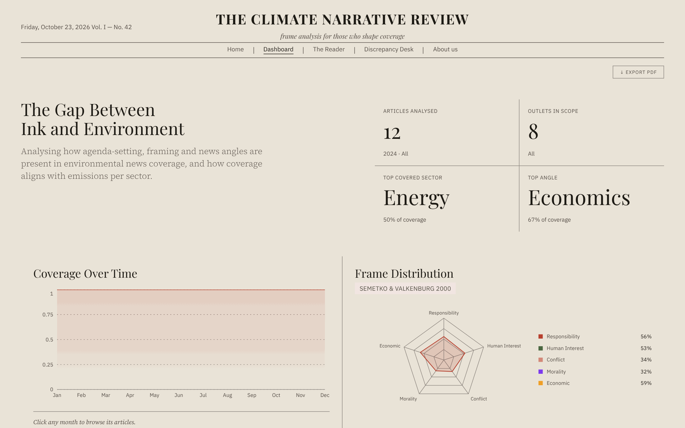
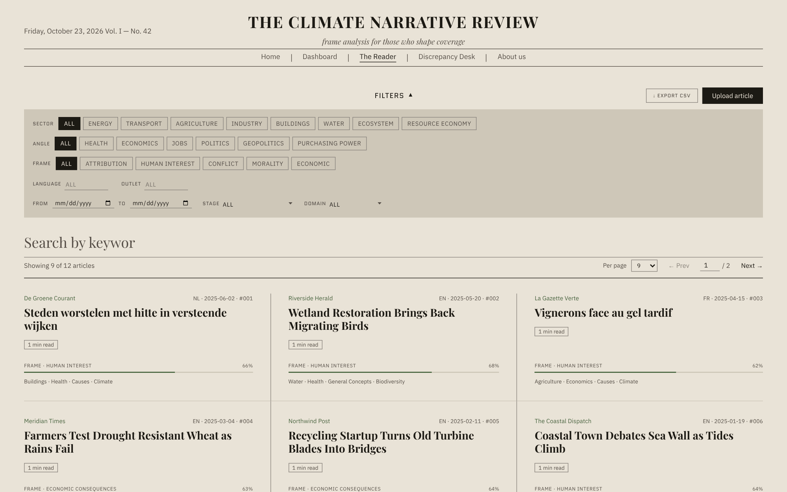
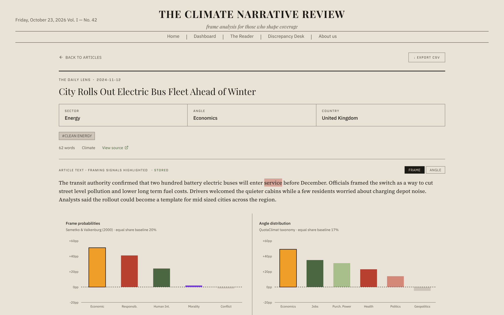
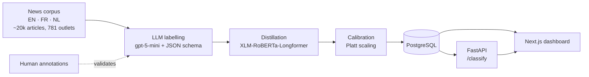

# QuotaClimat · Climate Media-Framing Analysis


A dashboard and classification pipeline that tracks **how news outlets frame environmental crises**, by sector, by frame (conflict, economic consequences, human interest, morality, responsibility) and by angle. Built as a University of Amsterdam capstone with [QuotaClimat](https://www.quotaclimat.org/), a French climate-media watchdog, to support its evidence work for French media regulator ARCOM.

---

<p align="center">
  
</p>

| The Reader: filter and search articles | Article view: classifier output and highlighted signals |
|---|---|
|  |  |

<sub>Screenshots use the synthetic demo dataset included in the repo.</sub>

---

## How it works



1. **LLM labelling.** `gpt-5-mini` labels frames and angles with language-specific prompts and a JSON schema for guided decoding ([`backend/analysis/prompts/`](backend/analysis/prompts/)).
2. **Validation.** LLM labels were checked against human annotators (Krippendorff's α and per-frame F1). Because LLM labels are systematically biased, frame distributions are estimated with prediction-powered inference (PPI).
3. **Distillation.** The labels are distilled into a multilingual `XLM-RoBERTa-Longformer` classifier with W&B hyperparameter sweeps, so the corpus can be classified cheaply and offline.
4. **Serving.** A FastAPI service runs calibrated inference and returns attention-based word importances, which the dashboard highlights in the article view.

## Results

| What | Result |
|---|---|
| LLM vs. human labels | Krippendorff's α 0.62–0.69 on 4 of 5 frames (0.28 on responsibility); F1 0.65–0.80 per frame |
| Distilled classifier (French) | Macro F1 **0.82** |
| Other tested languages | Within ~11% of the French baseline |
| Keyword baseline | Outperformed the keyword-based classifier used before |

The analysis also runs per-frame logistic regressions across causal-chain stages and sectors, with false-discovery-rate correction. See [`backend/analysis/Data Analysis.ipynb`](backend/analysis/Data%20Analysis.ipynb).

## Features

- **Overview:** frame and angle distributions across sectors and outlets
- **Newspapers:** per-outlet framing profiles
- **Search:** filter articles by frame, angle, sector, country and outlet
- **Article view:** classifier probabilities with highlighted words that drove the prediction
- **Upload:** classify new articles (PDF, DOCX or text) through the live model
- **CSV export** of any filtered view

## Quick start

**Requirements:** Node.js 18+, Docker, Python 3.11+

```bash
npm install
cp .env.example .env

# Start Postgres and load the synthetic demo data
docker compose up -d
docker compose exec -T db psql -U quota quota_climate < backend/db/seed_demo.sql

# Start Next.js + the FastAPI classifier backend
npm run dev:full
```

Open [http://localhost:3000](http://localhost:3000).

The demo seed contains fabricated sample articles, so the app runs standalone without any third-party content.

<details>
<summary><b>Windows (PowerShell)</b></summary>

```powershell
Get-Content backend/db/seed_demo.sql | docker compose exec -T db psql -U quota quota_climate
```

If restoring a full dump fails with a backslash or encoding error:

```powershell
$in = "$PWD\backend\analysis\datasets\quota_climate_dump.sql"
$out = "$PWD\backend\analysis\datasets\quota_climate_utf8.sql"
[System.IO.File]::WriteAllLines($out, [System.IO.File]::ReadLines($in), [System.Text.Encoding]::UTF8)
docker compose cp "$out" db:/tmp/dump_utf8.sql
docker compose exec db sh -c "tr -d '\r' < /tmp/dump_utf8.sql > /tmp/dump_final.sql && psql -v ON_ERROR_STOP=1 -U quota -d quota_climate -f /tmp/dump_final.sql"
Remove-Item -Path "$out" -ErrorAction SilentlyContinue
docker compose exec db sh -c "rm -f /tmp/dump_utf8.sql /tmp/dump_final.sql"
```

</details>

### Commands

| Command | What it does |
|---|---|
| `npm run dev` | Next.js dev server only |
| `npm run dev:full` | Next.js + FastAPI backend (port 8000) |
| `npm run build` | Production build |
| `npm run prod:full` | Production Next.js + backend |
| `npm run lint` | ESLint |

### Database

PostgreSQL 16 runs in Docker, with data persisted in the `pgdata` volume. The schema in [`backend/db/schema.sql`](backend/db/schema.sql) is applied on first start.

```bash
docker compose up -d     # start
docker compose down      # stop, keep data
docker compose down -v   # stop and delete data
```

### Models

Classifier weights are large binaries and are **not** included. The dashboard, search and demo data work without them, because classifications are stored in the database. You only need them for live classification (`/classify` and uploads).

- **Retrain** with the code and prompts in [`backend/analysis/`](backend/analysis/), or
- **Request the weights** by opening an issue.

Store checkpoints **outside** the project directory and point `FRAME_MODEL_PATH` / `ANGLE_MODEL_PATH` in `.env` at them. Inside the repo, the Next.js dev server watches them and slows every request down.

Without a model, the article view falls back to illustrative word highlights from [`lib/mockExplanations.ts`](lib/mockExplanations.ts). With a model, it shows the classifier's real attention scores.

## Data

The corpus was collected through university-licensed access to a news database, using sector-specific Boolean queries (transport, energy, agriculture, buildings, industry, water, ecosystems, resource economy) in English, French and Dutch. Articles were de-duplicated, ingested into PostgreSQL ([`backend/db/`](backend/db/)) and classified with the models above.

Article text and collection tooling are **not** redistributed, because the corpus is licensed third-party content. This repository contains the analysis and presentation layers plus a synthetic sample.

## Project structure

| Path | Contents |
|---|---|
| [`app/`](app/) | Next.js pages and API routes |
| [`components/`](components/) | Dashboard UI components |
| [`lib/`](lib/) | Data access, types, CSV export |
| [`backend/main.py`](backend/main.py) | FastAPI classification service |
| [`backend/analysis/`](backend/analysis/) | LLM labelling, training, calibration, analysis notebook ([details](backend/analysis/README.md)) |
| [`backend/db/`](backend/db/) | Schema, ingestion and seed data |

## Team

Built by a 5-person student team at the University of Amsterdam, with [Mark Temchenko](https://github.com/MarkT-D) as technical lead (architecture, data pipeline, backend and frontend), in partnership with QuotaClimat.
